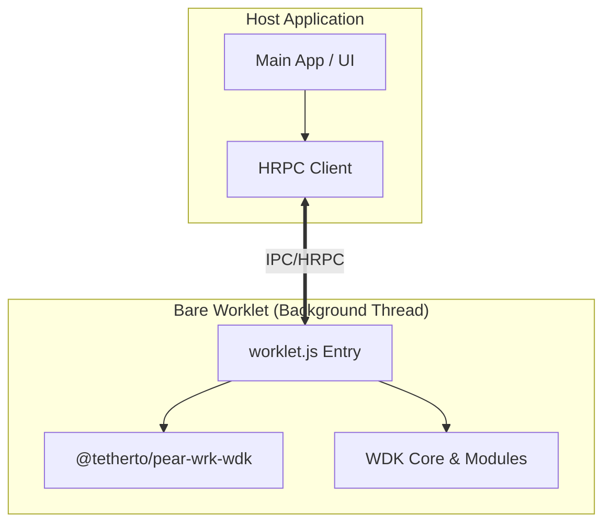

# @tetherto/pear-wrk-wdk

The foundational infrastructure for running the Tether Wallet Development Kit (WDK) inside a **Bare Worklet**.

This package provides the primitives—RPC handlers, lifecycle management, and secure secret storage—to host WDK modules in a separate thread. This architecture allows you to run a full Javascript-based wallet stack anywhere the Bare runtime is embedded (Mobile, Desktop, Server, or Embedded devices) while keeping heavy cryptographic operations isolated from your main application thread.

See the [Pear Worklet WDK documentation](https://docs.wdk.tether.io/tools/pear-wrk-wdk/).

## What is a Bare Worklet?

A **Bare Worklet** is a lightweight, isolated JavaScript environment (similar to a thread) running within the Bare runtime. Unlike standard Node.js workers, Worklets are designed for the Pear ecosystem to provide high-performance, non-blocking execution contexts.

In the context of a wallet, the Worklet acts as a "security enclave" running in the background. It holds the private keys in memory and performs signing operations, while your main application (the UI) simply sends requests to it.

## Why Use This?

The WDK is written in JavaScript, making it highly portable. However, cryptographic operations and network requests can be resource-intensive.

This package enables a **Worklet Architecture** where:
*   **Write Once, Run Anywhere**: You define your wallet logic (WDK setup) once in JavaScript.
*   **Thread Isolation**: The wallet runs in a dedicated Bare background thread, preventing UI freezes or main-process blocking on any platform.
*   **Secure & Standardized**: It provides a pre-built HRPC (Hyper RPC) bridge to communicate securely between your Host Application and the Wallet Worklet.

## Architecture

This package acts as the infrastructure layer for your worklet, handling the "plumbing" so you can focus on the wallet logic.



## Implementation Guide

While this package provides the core infrastructure, you typically don't need to implement everything manually. We provide high-level tooling to generate the worklet and consume it easily.

### Recommended: Automated Tooling

> **Note**: You likely do not need to install `@tetherto/pear-wrk-wdk` directly. It is a low-level dependency used internally by the higher-level libraries.

1.  **Generate the Worklet**: Install **[`@tetherto/wdk-worklet-bundler`](https://github.com/tetherto/wdk-worklet-bundler)** (usually as a dev dependency). It provides a CLI to automatically generate the worklet entry file based on your WDK modules configuration.
2.  **Connect in your App**: Install **[`@tetherto/wdk-react-native-core`](https://github.com/tetherto/wdk-react-native-core)** (or other platform-specific core libraries). This provides ready-to-use hooks to interact with the worklet without needing to manually manage the HRPC connection or the worklet lifecycle.

### Manual Implementation (For Custom Setups)

If you are building a custom integration (e.g., for Desktop, Server, or a custom Bare embedding) and cannot use the pre-built tools, you can implement the architecture manually using the primitives in this package.

The package has one export for each side, and one for each transport class:

| Export | Where it runs | What it gives |
|---|---|---|
| `@tetherto/pear-wrk-wdk` | The host and the build, outside Bare | `HRPC`, `createServerProvider` |
| `@tetherto/pear-wrk-wdk/worklet` | The worklet, inside Bare | `registerRpcHandlers`, `createStart`, `utils`, `exceptions` |
| `@tetherto/pear-wrk-wdk/hrpc` | Either side | The `HRPC` class |
| `@tetherto/pear-wrk-wdk/bare-rpc` | Either side | The `BareRPC` class |

`./worklet` exports no transport class. The worklet requires the one it serves, from `./hrpc` or from `./bare-rpc`, so that its bundle carries the code of that transport only.

#### 1. The Worklet Entry (Background Context)

Create an entry file (e.g., `src/worklet.js`) for your background thread. This file configures *which* WDK modules are available. This script runs inside the Bare worklet environment.

```javascript
/* src/worklet.js */
const { registerRpcHandlers } = require('@tetherto/pear-wrk-wdk/worklet')
const { WDK } = require('@tetherto/wdk')

// Import the specific wallet managers you need
const EvmWalletManager = require('@tetherto/wdk-wallet-evm')
const SparkWalletManager = require('@tetherto/wdk-wallet-spark')

// Define the context
// This tells the infrastructure which modules to expose to the host
const context = {
  WDK, 
  walletManagers: {
    ethereum: EvmWalletManager,
    spark: SparkWalletManager
  },
  protocolManagers: {}, // e.g. AAVE, Uniswap adapters
  requiredNetworks: ['ethereum', 'spark'],
  wdk: null, // Initialized via RPC later

  // Optional, for debug builds only: errors returned to the host then also
  // carry their stack traces. Leave it out of a production build.
  debug: false,

  // Optional but recommended: without this, callMethod can invoke any method
  // on the resolved account/protocol object, including fund-moving or
  // key-export operations. Listing a network or protocol here restricts it
  // to just the given methods; anything left out stays unrestricted, so you
  // can lock this down one surface at a time.
  allowedMethods: {
    ethereum: {
      methods: ['getAddress', 'getBalance', 'sendTransaction'],
      protocols: { swap: { uniswap: { methods: ['quoteSwap'] } } }
    }
  },

  // Optional but recommended: without this, callModule can invoke any
  // method on a bundled module instance (e.g. an address book). Keyed by
  // module name; a module left out stays unrestricted.
  allowedModuleMethods: {
    addressBook: { methods: ['list', 'add'] }
  }
}

// Bind the standard WDK RPC handlers to the provided RPC server
module.exports = (rpc) => {
  registerRpcHandlers(rpc, context)
}
```

#### 2. The Host Client (Main Context)

In your main application (whether it's a CLI, a Mobile App, or a Desktop App), you connect to the worklet using the `HRPC` client.

```javascript
const { HRPC } = require('@tetherto/pear-wrk-wdk')
const IPC = require('bare-ipc')

// Initialize the connection to the worklet
// The specific IPC setup depends on how you embed Bare (e.g. bare-kit, pear)
const ipc = new IPC() 
const hrpc = new HRPC(ipc)

// 1. Secrets Management (Happens inside the worklet)
// Generates entropy and encrypts it in memory immediately
const secrets = await hrpc.generateEntropyAndEncrypt({ wordCount: 12 })

// 2. Initialize the WDK
await hrpc.initializeWDK({
  encryptionKey: secrets.encryptionKey,
  encryptedSeed: secrets.encryptedSeedBuffer,
  config: JSON.stringify({
    networks: {
      ethereum: { 
        blockchain: 'ethereum', 
        config: { rpcUrl: 'https://...' } 
      }
    }
  })
})

// 3. Execute Wallet Methods
// The call is serialized, sent to the worklet, executed, and returned
const address = await hrpc.callMethod({
  methodName: 'getAddress',
  network: 'ethereum',
  accountIndex: 0
})
```

#### 3. The bare-rpc transport

The same commands are also served over plain [`bare-rpc`](https://github.com/holepunchto/bare-rpc), for hosts that have a `bare-rpc` client but no HRPC one (Swift, Kotlin). `BareRPC` has the same methods as `HRPC` and is generated from the same two files, `schema.json` and `src/hrpc/hrpc.json`, so the worklet registers the same handlers on either:

```javascript
const BareRPC = require('@tetherto/pear-wrk-wdk/bare-rpc')

// In the worklet
registerRpcHandlers(new BareRPC(ipc), context)

// In a JavaScript host
const rpc = new BareRPC(ipc)
const secrets = await rpc.generateEntropyAndEncrypt({ wordCount: 12 })
```

*   **Commands**: The command id is the `id` in `src/hrpc/hrpc.json`. `log` and `moduleEvent` are events (they have no response); the others are requests.
*   **Payloads**: The request and the response are the structs of `schema.json` written as JSON. A field of type `buffer` is a base64 string. A request with no fields can be sent with no payload.
*   **Errors**: The same as on HRPC, see [Errors](#errors). The `message` of the `bare-rpc` error is the JSON string and its `code` is the code.
*   **Limits**: `new BareRPC(stream, { maxFrameSize, maxBufferedBytes })`. Both default to 16 MiB (`BareRPC.DEFAULT_MAX_FRAME_SIZE`, `BareRPC.DEFAULT_MAX_BUFFERED_BYTES`). A frame above `maxFrameSize` ends the session.

#### 4. Packing the worklet with bare-stow

[`bare-stow`](https://github.com/holepunchto/bare-stow) packs the worklet and generates the code that starts it from the host. It needs two things from this package.

The entry file of the bundle exports what `createStart` returns. `bare-stow` calls it when the worklet starts, with the transport already attached to the IPC, and calls the function it gets back before the worklet exits:

```javascript
/* src/worklet.js */
const { createStart } = require('@tetherto/pear-wrk-wdk/worklet')

const context = { /* the same context as in step 1 */ }

module.exports = createStart(context)
```

*   **Start**: Registers the handlers of every command. The worklet is reported as ready once it has returned.
*   **Stop**: Does what a full `dispose` does: disposes the WDK instance, zeroes the seed and closes the modules. If the WDK instance fails to dispose, it rejects with the error `dispose` would answer with.

The transport is chosen where the bundle is built, by the server provider given to `bare-stow`. Only the code of that transport is packed:

```javascript
/* build script (Node) */
const stow = require('bare-stow')
const { createServerProvider } = require('@tetherto/pear-wrk-wdk')

// 'bare-rpc' takes the limits of the session; 'hrpc' takes no options
const server = createServerProvider('bare-rpc', { maxFrameSize: 4 * 1024 * 1024 })

for await (const artifact of stow('./src/worklet.js', 'bare-kit', './out', { language: 'swift', client: 'bare-rpc', server })) {
  console.log(artifact.url.href)
}
```

The provider only generates the worklet side. The host side is the `client` option of `bare-stow`.

## API Reference

### Secrets & Security
*   **`generateEntropyAndEncrypt(wordCount)`**: Generates BIP39 mnemonics and encrypts them immediately in the worklet memory. Returns `encryptionKey`, `encryptedSeedBuffer`, and `encryptedEntropyBuffer`.
*   **`getMnemonicFromEntropy(encryptedEntropy, key)`**: Decrypts and returns the mnemonic.
*   **`getSeedAndEntropyFromMnemonic(mnemonic)`**: Migrates an existing mnemonic into the secure encrypted storage format.

### WDK Lifecycle
*   **`initializeWDK(params)`**: Boots up the WDK instance inside the worklet.
    *   `encryptionKey`: The key to decrypt the seed (returned by `generateEntropyAndEncrypt`).
    *   `encryptedSeedBuffer`: The encrypted seed buffer (returned by `generateEntropyAndEncrypt`).
    *   `config`: JSON stringified configuration object (must contain `networks`).
*   **`dispose(params)`**: Tears down the WDK instance and clears sensitive memory. Resolves with `{ status: 'disposed' }` once the teardown has finished, and rejects if it failed.
    *   `blockchains`: Optional list of blockchains to dispose. The other wallets and the seed stay in place. Leave it out to dispose everything.
    *   The argument is required: call `dispose({})` for a full dispose.
*   **`ping()`**: Answers at once with an empty object, whether or not the WDK is initialized. It tells a host one thing: whether the worklet's event loop is still running. It says nothing about any other call. An answer can be late when other requests are doing CPU work (decryption, key derivation, signing), so give it a generous deadline before treating the worklet as stuck.

### Wallet Interaction
*   **`callMethod(params)`**: The primary gateway for all wallet actions.
    *   `methodName`: The WDK method to call (e.g., `sendTransaction`, `signMessage`).
    *   `network`: The target blockchain (e.g., `ethereum`).
    *   `accountIndex`: The index of the account to use (e.g., `0`).
    *   `args`: Arguments for the method (JSON-stringified).
    *   `options`: Additional options for the method (JSON-stringified).
    *   By default, `callMethod` can call any method on the resolved account/protocol object, including fund-moving or key-export operations — passing `context.allowedMethods` when registering handlers is optional but recommended to restrict this. See [Context Setup](#1-the-worklet-entry-background-context) above. Restricting is opt-in per network/protocol surface; anything not covered by `allowedMethods` remains unrestricted. A rejected call fails fast with a `METHOD_NOT_ALLOWED` error code, distinct from the `BAD_REQUEST` used when a method genuinely doesn't exist.

### Dynamic Registration
*   **`registerWallet(config)`**: Add support for a new blockchain network at runtime.
*   **`registerProtocol(config)`**: Add support for a new protocol (e.g., DeFi adapter) at runtime.

### Errors
A call that fails rejects with an error whose `message` is a JSON string, and whose `code` is the same code the JSON carries:

```json
{ "code": "WALLET_ERROR",
  "name": "TransactionError",
  "message": "No unspent outputs available.",
  "details": { "reason": "INSUFFICIENT_BALANCE" },
  "causes": [
    { "name": "HttpError", "message": "429 Too Many Requests", "details": { "httpStatus": 429 } }
  ] }
```

*   **`code`**: Always one of the codes below. It says where the call failed.
    *   `BAD_REQUEST`: The request is missing or not valid.
    *   `METHOD_NOT_ALLOWED`: The method is not in the list of allowed methods.
    *   `DECRYPTION_FAILED`: The seed (`initializeWDK`) or the entropy (`getMnemonicFromEntropy`) could not be decrypted with the given key. The message says which of the two.
    *   `WDK_MANAGER_INIT`: The WDK is not initialized, or it failed to initialize.
    *   `WALLET_ERROR`, `PROTOCOL_ERROR`, `MODULE_ERROR`: A wallet, a protocol or a module threw.
    *   `INTERNAL_ERROR`: An unexpected failure in the worklet's own code.
*   **`name`** and **`message`**: Those of the error that was thrown.
*   **`details`**: Every property of that error whose value is a string, a number or a boolean, such as the `reason` of a wallet error. A code set by a library is here, as `details.code`. Left out when there is none.
*   **`causes`**: The errors under the thrown one (its `cause` chain), each with its own `name`, `message` and `details`. Left out when there is none.
*   **`stack`**: The stack trace of the thrown error, and of each cause. Only present when the worklet was built with `debug: true` in its context. It is off by default, a host cannot turn it on, and it is not meant for production builds.

## License
This project is licensed under the Apache License 2.0 - see the [LICENSE](LICENSE) file for details.
