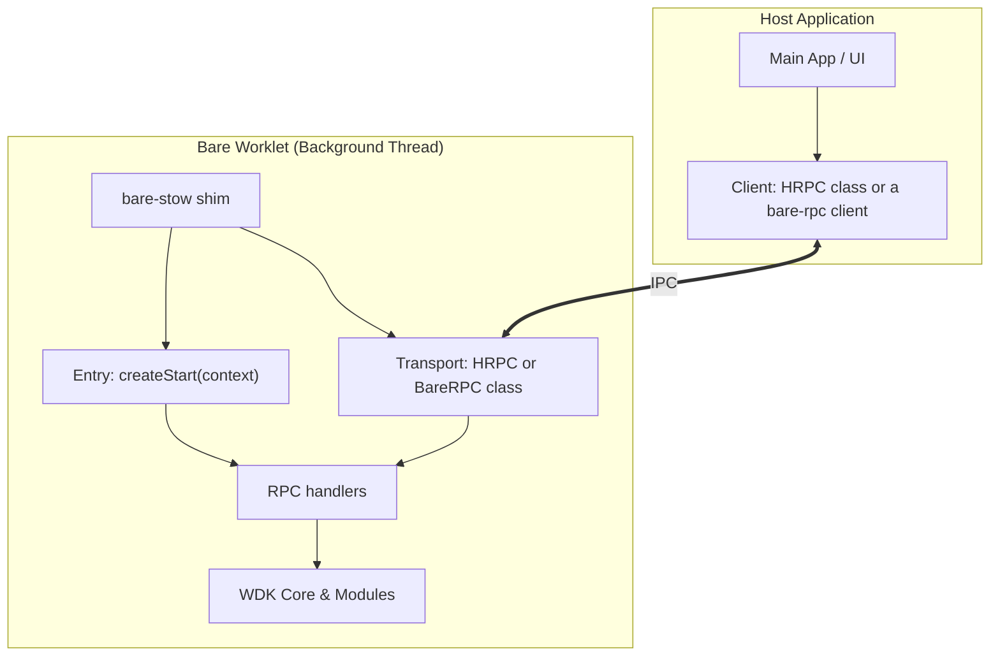

# @tetherto/pear-wrk-wdk

The foundational infrastructure for running the Tether Wallet Development Kit (WDK) inside a **Bare Worklet**.

This package provides the primitives—RPC handlers, lifecycle management, and secure secret storage—to host WDK modules in a separate thread. This architecture allows you to run a full Javascript-based wallet stack anywhere the Bare runtime is embedded (Mobile, Desktop, Server, or Embedded devices) while keeping heavy cryptographic operations isolated from your main application thread.

See the [Pear Worklet WDK documentation](https://docs.wdk.tether.io/tools/pear-wrk-wdk/).

> [!NOTE]
> This is the README of the **RC line** (branch `next`). The worklet is served over `bare-rpc` or HRPC and is packed with `bare-stow`. The JSON-RPC transport is only on the LTS line (branch `main`). See [Release lines](#release-lines).

## What is a Bare Worklet?

A **Bare Worklet** is a lightweight, isolated JavaScript environment (similar to a thread) running within the Bare runtime. Unlike standard Node.js workers, Worklets are designed for the Pear ecosystem to provide high-performance, non-blocking execution contexts.

In the context of a wallet, the Worklet acts as a "security enclave" running in the background. It holds the private keys in memory and performs signing operations, while your main application (the UI) simply sends requests to it.

## Why Use This?

The WDK is written in JavaScript, making it highly portable. However, cryptographic operations and network requests can be resource-intensive.

This package enables a **Worklet Architecture** where:
*   **Write Once, Run Anywhere**: You define your wallet logic (WDK setup) once in JavaScript.
*   **Thread Isolation**: The wallet runs in a dedicated Bare background thread, preventing UI freezes or main-process blocking on any platform.
*   **Secure & Standardized**: It provides a pre-built RPC bridge between your Host Application and the Wallet Worklet, over `bare-rpc` or HRPC (Hyper RPC), with the same commands on both.

## Release lines

The package has two lines. They differ in the transports the worklet serves and in how the worklet is started.

| | LTS line | RC line (this README) |
|---|---|---|
| Branch | `main` | `next` |
| Versions | `1.0.0-beta.x` | `1.0.0-rc.x` |
| npm dist-tag | `latest` | `next` |
| Transports | HRPC, JSON-RPC | HRPC, `bare-rpc` |
| How the worklet starts | The entry wires the IPC itself | [`bare-stow`](https://github.com/holepunchto/bare-stow) calls the entry |
| Used by | `wdk-react-native-core`, and `wdk-core-swift` and `wdk-core-kotlin` v0.9.x | The Swift and Kotlin cores that are packed with `bare-stow` |

A host and a worklet must come from the same line: `dispose` and the error format are not the same on both.

```
npm i @tetherto/pear-wrk-wdk@next
```

## Architecture

This package acts as the infrastructure layer for your worklet, handling the "plumbing" so you can focus on the wallet logic.



*   **One set of commands.** The commands and their fields are declared once, in `schema.json` and `src/hrpc/hrpc.json`. `npm run gen:rpcs` generates one class per transport from them, `HRPC` and `BareRPC`, with the same methods.
*   **One handler file.** `registerRpcHandlers(rpc, context)` registers the same handlers on an instance of either class, so the two transports cannot drift apart.
*   **Two transports.** HRPC encodes each request and response in binary. `bare-rpc` carries them as JSON, for hosts that have a `bare-rpc` client but no HRPC one (Swift, Kotlin). Both run on the framing of [`bare-rpc`](https://github.com/holepunchto/bare-rpc).
*   **Started by bare-stow.** [`bare-stow`](https://github.com/holepunchto/bare-stow) packs the worklet into a bundle and puts a small shim in front of the entry. When the worklet starts, the shim attaches the transport to the IPC and calls the entry with it. Before the worklet exits, it calls the function the entry returned.

## Implementation Guide

While this package provides the core infrastructure, you typically don't need to implement everything manually. We provide high-level tooling to generate the worklet and consume it easily.

### Recommended: Automated Tooling

> **Note**: You likely do not need to install `@tetherto/pear-wrk-wdk` directly. It is a low-level dependency used internally by the higher-level libraries.

1.  **Generate the Worklet**: Install **[`@tetherto/wdk-worklet-bundler`](https://github.com/tetherto/wdk-worklet-bundler)** (usually as a dev dependency). It provides a CLI to automatically generate the worklet entry file based on your WDK modules configuration, and to pack it.
2.  **Connect in your App**: Install the core library of your platform. It provides a ready-to-use API to interact with the worklet without needing to manually manage the connection or the worklet lifecycle. React Native apps use **[`@tetherto/wdk-react-native-core`](https://github.com/tetherto/wdk-react-native-core)**, which is on the LTS line.

### Manual Implementation (For Custom Setups)

If you are building a custom integration (e.g., for Desktop, Server, or a custom Bare embedding) and cannot use the pre-built tools, you can implement the architecture manually using the primitives in this package.

The package has one export for each side, and one for each transport class:

| Export | Where it runs | What it gives |
|---|---|---|
| `@tetherto/pear-wrk-wdk` | The host and the build, outside Bare | `HRPC`, `createServerProvider` |
| `@tetherto/pear-wrk-wdk/worklet` | The worklet, inside Bare | `registerRpcHandlers`, `createStart`, `utils`, `exceptions` |
| `@tetherto/pear-wrk-wdk/hrpc` | Either side | The `HRPC` class |
| `@tetherto/pear-wrk-wdk/bare-rpc` | Either side | The `BareRPC` class |

`./worklet` exports no transport class. The worklet requires the one it serves, from `./hrpc` or from `./bare-rpc`, so that its bundle carries the code of that transport only.

#### 1. The Worklet Entry (Background Context)

Create an entry file (e.g., `src/worklet.js`) for your background thread. This file configures *which* WDK modules are available. This script runs inside the Bare worklet environment.

```javascript
/* src/worklet.js */
const { createStart } = require('@tetherto/pear-wrk-wdk/worklet')
const { WDK } = require('@tetherto/wdk')

// Import the specific wallet managers you need
const EvmWalletManager = require('@tetherto/wdk-wallet-evm')
const SparkWalletManager = require('@tetherto/wdk-wallet-spark')

// Define the context
// This tells the infrastructure which modules to expose to the host
const context = {
  WDK, 
  walletManagers: {
    ethereum: EvmWalletManager,
    spark: SparkWalletManager
  },
  protocolManagers: {}, // e.g. AAVE, Uniswap adapters
  requiredNetworks: ['ethereum', 'spark'],
  wdk: null, // Initialized via RPC later

  // Optional, for debug builds only: errors returned to the host then also
  // carry their stack traces. Leave it out of a production build.
  debug: false,

  // Optional but recommended: without this, callMethod can invoke any method
  // on the resolved account/protocol object, including fund-moving or
  // key-export operations. Listing a network or protocol here restricts it
  // to just the given methods; anything left out stays unrestricted, so you
  // can lock this down one surface at a time.
  allowedMethods: {
    ethereum: {
      methods: ['getAddress', 'getBalance', 'sendTransaction'],
      protocols: { swap: { uniswap: { methods: ['quoteSwap'] } } }
    }
  },

  // Optional but recommended: without this, callModule can invoke any
  // method on a bundled module instance (e.g. an address book). Keyed by
  // module name; a module left out stays unrestricted.
  allowedModuleMethods: {
    addressBook: { methods: ['list', 'add'] }
  }
}

// The entry bare-stow runs: it binds the standard WDK RPC handlers to the
// transport when the worklet starts, and disposes the WDK when it stops
module.exports = createStart(context)
```

*   **Start**: `bare-stow` calls the entry with the transport already attached to the IPC. The entry registers the handlers of every command, and the worklet is reported as ready once it has returned.
*   **Stop**: Before the worklet exits, `bare-stow` calls the function the entry returned. It does what a full `dispose` does: disposes the WDK instance, zeroes the seed and closes the modules. If the WDK instance fails to dispose, it rejects with the error `dispose` would answer with.

In an embedding that does not use `bare-stow`, create the transport yourself and register the handlers on it: `registerRpcHandlers(new HRPC(ipc), context)`, with `HRPC` from `@tetherto/pear-wrk-wdk/hrpc` or `BareRPC` from `@tetherto/pear-wrk-wdk/bare-rpc`. Stopping the worklet is then up to you.

#### 2. Packing the Worklet with bare-stow

The transport is chosen where the bundle is built, by the server provider given to `bare-stow`. Only the code of that transport is packed:

```javascript
/* build script (Node) */
const path = require('path')
const { pathToFileURL } = require('url')
const stow = require('bare-stow')
const { createServerProvider } = require('@tetherto/pear-wrk-wdk')

async function pack () {
  // 'bare-rpc' takes the limits of the session; 'hrpc' takes no options
  const server = createServerProvider('bare-rpc', { maxFrameSize: 4 * 1024 * 1024 })

  // bare-stow takes the entry and the output folder as file: URLs
  const entry = pathToFileURL(path.resolve('src/worklet.js'))
  const out = pathToFileURL(path.resolve('out') + path.sep)

  for await (const artifact of stow(entry, 'bare-kit', out, { language: 'swift', client: 'bare-rpc', server })) {
    console.log(artifact.url.href)
  }
}

pack()
```

The provider only generates the worklet side. The host side is the `client` option of `bare-stow`, and the package it writes to `./out` has the code that starts the worklet from the host.

#### 3. A JavaScript Host

A host written in JavaScript uses the same generated class as the worklet, on the other end of the IPC: `HRPC` or `BareRPC`. They have the same methods.

```javascript
const { HRPC } = require('@tetherto/pear-wrk-wdk')
// or: const BareRPC = require('@tetherto/pear-wrk-wdk/bare-rpc')

// `ipc` is the stream to the worklet. Where it comes from depends on how
// you embed Bare: with bare-stow it is the `ipc` that the generated
// `start()` resolves with
const hrpc = new HRPC(ipc)

// 1. Secrets Management (Happens inside the worklet)
// Generates entropy and encrypts it in memory immediately
const secrets = await hrpc.generateEntropyAndEncrypt({ wordCount: 12 })

// 2. Initialize the WDK
await hrpc.initializeWDK({
  encryptionKey: secrets.encryptionKey,
  encryptedSeed: secrets.encryptedSeedBuffer,
  config: JSON.stringify({
    networks: {
      ethereum: { 
        blockchain: 'ethereum', 
        config: { rpcUrl: 'https://...' } 
      }
    }
  })
})

// 3. Execute Wallet Methods
// The call is serialized, sent to the worklet, executed, and returned.
// The result comes back as JSON
const { result } = await hrpc.callMethod({
  methodName: 'getAddress',
  network: 'ethereum',
  accountIndex: 0
})
const address = JSON.parse(result)

// 4. Dispose the WDK and clear the seed
await hrpc.dispose({})
```

`new BareRPC(stream, { maxFrameSize, maxBufferedBytes })` also takes the limits of the session. Both default to 16 MiB (`BareRPC.DEFAULT_MAX_FRAME_SIZE`, `BareRPC.DEFAULT_MAX_BUFFERED_BYTES`).

#### 4. A Host in Another Language: bare-rpc on the Wire

A host that is not JavaScript talks to a worklet that serves `bare-rpc` with a `bare-rpc` client, such as [`bare-rpc-swift`](https://github.com/holepunchto/bare-rpc-swift) or [`bare-rpc-kotlin`](https://github.com/holepunchto/bare-rpc-kotlin). The client does the framing. What this package defines is the command ids and what goes in the payload.

**Commands.** A command is sent by its id. The ids, and the fields of each request and response, are those of `src/hrpc/hrpc.json` and `schema.json`, which are the reference:

| Id | Command | Kind | Request | Response |
|---|---|---|---|---|
| 0 | `log` | event, worklet to host | `type?`, `data?` | |
| 1 | `workletStart` | request | | `status` |
| 2 | `dispose` | request | `blockchains?` | `status` |
| 3 | `callMethod` | request | `methodName`, `network`, `accountIndex`, `args?`, `options?` | `result` |
| 4 | `generateEntropyAndEncrypt` | request | `wordCount` | `encryptionKey`, `encryptedSeedBuffer`, `encryptedEntropyBuffer` |
| 5 | `getMnemonicFromEntropy` | request | `encryptedEntropy`, `encryptionKey` | `mnemonic` |
| 6 | `initializeWDK` | request | `encryptionKey?`, `encryptedSeed?`, `config` | `status` |
| 7 | `getSeedAndEntropyFromMnemonic` | request | `mnemonic` | `encryptionKey`, `encryptedSeedBuffer`, `encryptedEntropyBuffer` |
| 8 | `registerWallet` | request | `config` | `status`, `blockchains` |
| 9 | `registerProtocol` | request | `config` | `status` |
| 10 | `resetWdkWallets` | request | `config` | `status` |
| 11 | `callModule` | request | `module`, `method`, `args?` | `result` |
| 12 | `moduleEvent` | event, worklet to host | `module`, `event`, `payload?` | |
| 13 | `ping` | request | | |

**Payloads.** The payload of a request or a response is its fields as one JSON object, in UTF-8.

*   A field of type `buffer` (the keys and the encrypted seed and entropy) is a base64 string.
*   `accountIndex` and `wordCount` are numbers. `blockchains` in the request of `dispose` is an array of strings.
*   `config`, `args`, `options`, `result`, `payload` and the `blockchains` of the `registerWallet` response are strings that hold JSON, as they are over HRPC. They are not parsed or built by the transport.
*   A request that has no fields, or whose fields are all left out, can be sent with no payload.

For example, `initializeWDK` is a request with command id `6` and this payload:

```json
{ "encryptionKey": "AAECAwQFBgcICQoLDA0ODxAREhMUFRYXGBkaGxwdHh8=",
  "encryptedSeed": "oaKjpKWmp6g=",
  "config": "{\"networks\":{\"ethereum\":{\"blockchain\":\"ethereum\",\"config\":{}}}}" }
```

and the payload of its response is:

```json
{ "status": "initialized" }
```

**Errors.** A request that fails is answered with an error of `bare-rpc`, which has a `message` and a `code`.

*   When the worklet fails the request, `code` is one of the codes in [Errors](#errors) and `message` is the JSON string described there. A payload that is not valid JSON is answered this way too, with `BAD_REQUEST`.
*   When `bare-rpc` itself fails it, `message` is plain text. A command id the worklet does not know is answered with the code `UNKNOWN_COMMAND`.

So read the `code` first, and parse the `message` as JSON only for the codes of this package.

**Events.** `moduleEvent` is sent by the worklet when a module emits an event, so the host registers a handler for the event with id `12`. `log` is declared for the logs of the worklet; the worklet does not send it yet. The worklet ignores an event it has no handler for.

**Limits.** The worklet accepts frames up to `maxFrameSize` and buffers up to `maxBufferedBytes` for a stream, 16 MiB each unless the server provider was given other values. A frame above `maxFrameSize` ends the session.

**Secrets.** JSON has no binary type, so over this transport the keys and the encrypted seed exist as base64 text on both sides. See [SECURITY.md](SECURITY.md) for what the worklet zeroes and what it cannot.

## API Reference

The methods below are those of the `HRPC` and `BareRPC` classes. Each takes one object with the fields of its request.

### Secrets & Security
*   **`generateEntropyAndEncrypt({ wordCount })`**: Generates a BIP39 mnemonic of 12 or 24 words and encrypts its seed and entropy immediately in the worklet memory. Returns `encryptionKey`, `encryptedSeedBuffer`, and `encryptedEntropyBuffer`.
*   **`getMnemonicFromEntropy({ encryptedEntropy, encryptionKey })`**: Decrypts and returns the mnemonic.
*   **`getSeedAndEntropyFromMnemonic({ mnemonic })`**: Migrates an existing mnemonic into the secure encrypted storage format. Returns the same three fields as `generateEntropyAndEncrypt`.

### WDK Lifecycle
*   **`workletStart()`**: Resolves with `{ status: 'started' }` once the handlers are registered.
*   **`initializeWDK(params)`**: Boots up the WDK instance inside the worklet.
    *   `encryptionKey`: The key to decrypt the seed (returned by `generateEntropyAndEncrypt`).
    *   `encryptedSeed`: The encrypted seed (returned by `generateEntropyAndEncrypt` as `encryptedSeedBuffer`).
    *   `config`: JSON stringified configuration object (must contain `networks`).
*   **`resetWdkWallets({ config })`**: Disposes the wallets of the given configuration and registers them again, on the WDK instance that is already initialized.
*   **`dispose(params)`**: Tears down the WDK instance and clears sensitive memory. Resolves with `{ status: 'disposed' }` once the teardown has finished, and rejects if it failed.
    *   `blockchains`: Optional list of blockchains to dispose. The other wallets and the seed stay in place. Leave it out to dispose everything. An empty list also disposes everything.
    *   The argument is required: call `dispose({})` for a full dispose.
*   **`ping()`**: Answers at once with an empty object, whether or not the WDK is initialized. It tells a host one thing: whether the worklet's event loop is still running. It says nothing about any other call. An answer can be late when other requests are doing CPU work (decryption, key derivation, signing), so give it a generous deadline before treating the worklet as stuck.

### Wallet Interaction
*   **`callMethod(params)`**: The primary gateway for all wallet actions.
    *   `methodName`: The WDK method to call (e.g., `sendTransaction`, `signMessage`).
    *   `network`: The target blockchain (e.g., `ethereum`).
    *   `accountIndex`: The index of the account to use (e.g., `0`).
    *   `args`: Arguments for the method (JSON-stringified).
    *   `options`: Additional options for the method (JSON-stringified).
    *   By default, `callMethod` can call any method on the resolved account/protocol object, including fund-moving or key-export operations — passing `context.allowedMethods` when registering handlers is optional but recommended to restrict this. See [Context Setup](#1-the-worklet-entry-background-context) above. Restricting is opt-in per network/protocol surface; anything not covered by `allowedMethods` remains unrestricted. A rejected call fails fast with a `METHOD_NOT_ALLOWED` error code, distinct from the `BAD_REQUEST` used when a method genuinely doesn't exist.

### Modules
*   **`callModule(params)`**: Calls a method of a module bundled in the worklet. It resolves with `{ result }`, the JSON of what the method returned (`null` when it returned nothing).
    *   `module`: The name of the module, as in `context.moduleManagers`.
    *   `method`: The method to call.
    *   `args`: Arguments for the method (JSON-stringified). An array is passed as the positional arguments, any other value as the single argument.
    *   `context.allowedModuleMethods` restricts the methods of a module, as `allowedMethods` does for `callMethod`. A worklet with no modules answers with `BAD_REQUEST`.
*   **`onModuleEvent(handler)`**: Registers the handler of the events the modules emit. It receives `{ module, event, payload }`, with `payload` as JSON.

### Dynamic Registration
*   **`registerWallet({ config })`**: Add support for a new blockchain network at runtime.
*   **`registerProtocol({ config })`**: Add support for a new protocol (e.g., DeFi adapter) at runtime.

### Errors
A call that fails rejects with an error whose `message` is a JSON string, and whose `code` is the same code the JSON carries:

```json
{ "code": "WALLET_ERROR",
  "name": "TransactionError",
  "message": "No unspent outputs available.",
  "details": { "reason": "INSUFFICIENT_BALANCE" },
  "causes": [
    { "name": "HttpError", "message": "429 Too Many Requests", "details": { "httpStatus": 429 } }
  ] }
```

*   **`code`**: Always one of the codes below. It says where the call failed.
    *   `BAD_REQUEST`: The request is missing or not valid.
    *   `METHOD_NOT_ALLOWED`: The method is not in the list of allowed methods.
    *   `DECRYPTION_FAILED`: The seed (`initializeWDK`) or the entropy (`getMnemonicFromEntropy`) could not be decrypted with the given key. The message says which of the two.
    *   `WDK_MANAGER_INIT`: The WDK is not initialized, or it failed to initialize.
    *   `WALLET_ERROR`, `PROTOCOL_ERROR`, `MODULE_ERROR`: A wallet, a protocol or a module threw.
    *   `INTERNAL_ERROR`: An unexpected failure in the worklet's own code.
*   **`name`** and **`message`**: Those of the error that was thrown.
*   **`details`**: Every property of that error whose value is a string, a number or a boolean, such as the `reason` of a wallet error. A code set by a library is here, as `details.code`. Left out when there is none.
*   **`causes`**: The errors under the thrown one (its `cause` chain), each with its own `name`, `message` and `details`. Left out when there is none.
*   **`stack`**: The stack trace of the thrown error, and of each cause. Only present when the worklet was built with `debug: true` in its context. It is off by default, a host cannot turn it on, and it is not meant for production builds.

## Development

*   **Generated code**: `npm run gen:rpcs` writes `generated/hrpc` and `generated/bare-rpc` from `schema.json` and `src/hrpc/hrpc.json`. The generated files are committed, and the build fails when they are stale.
*   **Adding a command**:
    1.  Add the structs of its request and response to `schema.json`.
    2.  Add the command to `src/hrpc/hrpc.json`, with the next free id. Ids are never reused or changed.
    3.  Run `npm run gen:rpcs`.
    4.  Register its handler in `src/rpc-handlers.js`, with one `rpc.on<Command>(...)` line.
    5.  Declare its types in `types/`.
*   **Tests**: `npm test` runs the unit tests in Node, and `npm run test:stow` runs the worklet under Bare. See [test/README.md](test/README.md).
*   **Secrets**: Read [SECURITY.md](SECURITY.md) before changing anything that touches a seed, a mnemonic, entropy or an encryption key.

## License
This project is licensed under the Apache License 2.0 - see the [LICENSE](LICENSE) file for details.
